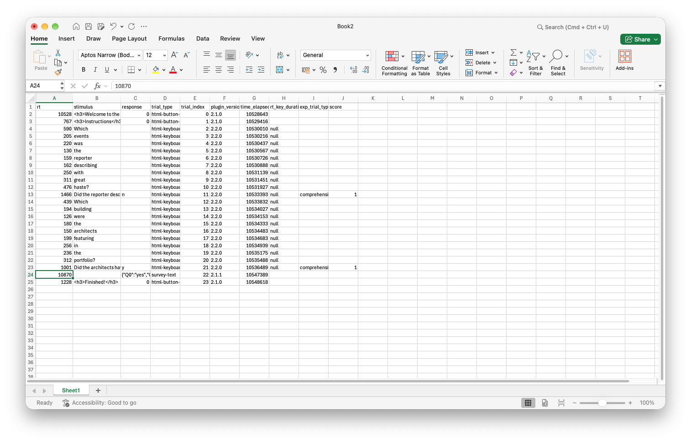

### How would you add extra trials to this code, i.e. additional sentences and related comprehension questions? You could experiment with just using or not using nested timelines and see which you prefer, conceptually and in terms of amount of repetitive labour!

This should be pretty easy and just involves copying, pasting, and **carefully** editing existing trials. 

So for example: the last trial in the code you were given looks like this:

```js
var spr_trial_2 = {
  type: jsPsychHtmlKeyboardResponse,
  choices: [" "],
  timeline: [
    { stimulus: "Which" },
    { stimulus: "building" },
    { stimulus: "were" },
    { stimulus: "the" },
    { stimulus: "architects" },
    { stimulus: "featuring" },
    { stimulus: "in" },
    { stimulus: "the" },
    { stimulus: "portfolio?" },
    {
      stimulus: "Did the architects have a portfolio?",
      prompt: "<p><em>Answer y or n</em></p>",
      choices: ["y", "n"],
      data: { exp_trial_type: "comprehension" },
      on_finish: function (data) {
        if (data.response == "y") { //here the correct response is "y" (yes)
          data.score = 1;
        } else {
          data.score = 0;
        }
      }
    },
  ],
};
```

and the timeline looks like this, with `spr_trial_2` slotted in at the end:

```js
var full_timeline = [
  consent_screen,
  instruction_screen_1,
  spr_trial_1,
  spr_trial_2,
  demographics_form,
  final_screen,
];
```

We can create a new trial, which we could call `spr_trial_3`, like this - I have marked all the places I had to edit, notice how careful you have to be if creating trials through this copy-and-paste method!

```js
//An extra trial
var spr_trial_3 = {
  type: jsPsychHtmlKeyboardResponse,
  choices: [" "],
  timeline: [ //lots of edits here to add different sentence
    { stimulus: "Which" }, 
    { stimulus: "paintings" },
    { stimulus: "were" },
    { stimulus: "the" },
    { stimulus: "students" },
    { stimulus: "discussing" },
    { stimulus: "during" },
    { stimulus: "the" },
    { stimulus: "break?" },
    {
      //edit to different comprehension question
      stimulus: "Did the students ignore the paintings during the break?",
      prompt: "<p><em>Answer y or n</em></p>",
      choices: ["y", "n"],
      data: { exp_trial_type: "comprehension" },
      on_finish: function (data) {
        if (data.response == "n") { //subtle edit here, the correct response is now "n"!
          data.score = 1;
        } else {
          data.score = 0;
        }
      }
    },
  ],
};
```

and add it at the end of the timeline:

```js
var full_timeline = [
  consent_screen,
  instruction_screen_1,
  spr_trial_1,
  spr_trial_2,
  spr_trial_3, //added here
  demographics_form,
  final_screen,
];
```

### Add another demographics question, e.g. asking for a list of other languages spoken by the participant.

This is going to involve messing with the `demographics_form` trial, which looks like this:

```js
var demographics_form = {
  type: jsPsychSurveyText,
  preamble:
    "<p style='text-align:left'> Please answer a few final questions about yourself and our experiment.</p>",
  questions: [
    {
      prompt: "Are you a native speaker of English?",
      placeholder: "Answer yes or no",
      required: true,
    },
    {
      prompt: "What is your age?",
      placeholder: "Age in years",
      required: true,
    },
    {
      prompt:
        "Is there anything we should know about the experiment or how you completed it? Did everything work smoothly?",
    },
  ],
};
```

Again we can just copy and paste one of those questions - the survey-text plugin takes a list of questions in a standard format.

```js
var demographics_form = {
  type: jsPsychSurveyText,
  preamble:
    "<p style='text-align:left'> Please answer a few final questions about yourself and our experiment.</p>",
  questions: [
    ...,//as before
    {
      prompt:
        "Please list all languages you speak fluently, in addition to English; if none, just write `None`",
      placeholder: "List languages here or write None",
      required: true,
    },
  ],
};
```

### Have a look at the data that is displayed at the end of the experiment. Can you see where the stimulus for each trial is recorded? Can you see where the crucial reaction time data for each trial is recorded? Can you see where the score for comprehension questions is recorded? Can you see how the demographics data is recorded?

The stimulus (a single word, or the comprehension question) is in the `stimulus` column, the reaction time data is in the `rt` column, and scores (which we added to the data) are recorded in a column titled `score` - this is the same as the name of the extra field we added to the `data` object. 

The demographics data is a bit harder to find. It's in the `response` column (which also records the key presses the participants made for the keyboard-response trials) but it's in a slightly opaque format. For `survey-text` trials, `data.response` includes a multiple responses, one per question in the survey - and this single entry includes them all in a single javascript object enclosed in curly brackets:

```js
{"Q0":"yes","Q1":"50","Q2":"no nothing really"}
```

For each question there's a label - Q0 for the first question, Q1 for the second question etc - and the response. 

### If you were going to analyse this kind of data, you would need to pull out the relevant trials (i.e. the ones involving self-paced reading, and comprehension questions). How would you identify comprehension trials and check if the participant had answered enough of these correctly (e.g. in excel)? How would you spot self-paced reading trials and look at their reaction times? If you were particularly interested in certain words in certain contexts, is it going to be easy to pull those trials out of the data the code produces? 

Here's what the data looks like after I paste it into Excel and format it a bit:



It's going to be reasonably easy to identify the self-paced reading and comprehension trials because those are the only trials that have "html-keyboard-response" in the trial_type column. I could if necessary differentiate the reading trials and the comprehension trials by looking at the response column - the reading trials all have " " as the response (a space!), the comprehension questions all have "y" or "n", and only the comprehension trials have a score. But also I have marked the comprehension trials as "comprehension" in the `exp_trial_type` columns, as we worked through in the practical. So I could quite easily count up how many comprehension trials were correct. But if I wanted to look e.g. at reading times for specific regions (wh-word, subject, verb, v+1 etc, as in the Enochson & Culbertson paper) it's not going to be particularly easy!

### Can you add some `exp_trial_type` information for the self-paced reading trials too, to mark them as distinct from the comprehension trials and also the various information screens? You might find it doesn't work quite as you expect, but it should be possible to find a work-around! Could you use the same method to add even more fine-grained information to the data, for example marking trials as belonging to "wh-", "aux", "subject", "verb", "V+1", "V+2", as used in the analyses and figures in [Enochson & Culbertson (2015)](https://doi.org/10.1371/journal.pone.0116946)? 

These trials involve nested timelines, and we can specify a default for the whole timeline that can be over-written as necessary, so a smart solution would be something like this: we specify the default data to be used for all trials, marking `exp_trial_type` as "self-paced reading", then in the comprehension question this should be over-written in the way that e.g. the choices for that specific trial are over-written.

```js
var spr_trial_1 = {
  type: jsPsychHtmlKeyboardResponse,
  choices: [" "], 
  data: { exp_trial_type: "self-paced reading" }, //specify default exp_trial_type
  timeline: [
    { stimulus: "Which" },
    { stimulus: "events" },
    { stimulus: "was" },
    { stimulus: "the" },
    { stimulus: "reporter" },
    { stimulus: "describing" },
    { stimulus: "with" },
    { stimulus: "great" },
    { stimulus: "haste?" },
    {
      stimulus: "Did the reporter describe the events slowly?",
      prompt: "<p><em>Answer y or n</em></p>",
      choices: ["y", "n"],
      data: { exp_trial_type: "comprehension" }, //over-ride here
      on_finish: function (data) {
        if (data.response == "n") {
          data.score = 1;
        } else {
          data.score = 0;
        }
      }
    },
  ],
};
```

This is the first thing I tried, and at that point discovered a bug in the current version of jsPsych where over-riding `data` doesn`t work as intended in nested timelines - [I reported this bug and it will be fixed in the next release version](https://github.com/jspsych/jsPsych/issues/3714), but it just shows you that even extremely competent coders can miss things, so hopefully that makes you feel less bad about your own errors! Instead, and for the time being, we have to do something more laborious and mark this for every trial.

```js
var spr_trial_1 = {
  type: jsPsychHtmlKeyboardResponse,
  choices: [" "], 
  timeline: [
    { stimulus: "Which", data: { exp_trial_type: "self-paced reading" } },
    { stimulus: "events", data: { exp_trial_type: "self-paced reading" } },
    { stimulus: "was", data: { exp_trial_type: "self-paced reading" } },
    { stimulus: "the", data: { exp_trial_type: "self-paced reading" } },
    { stimulus: "reporter", data: { exp_trial_type: "self-paced reading" } },
    { stimulus: "describing", data: { exp_trial_type: "self-paced reading" } },
    { stimulus: "with", data: { exp_trial_type: "self-paced reading" } },
    { stimulus: "great", data: { exp_trial_type: "self-paced reading" } },
    { stimulus: "haste?", data: { exp_trial_type: "self-paced reading" } },
    {
      stimulus: "Did the reporter describe the events slowly?",
      prompt: "<p><em>Answer y or n</em></p>",
      choices: ["y", "n"],
      data: { exp_trial_type: "comprehension" },
      on_finish: function (data) {
        if (data.response == "n") { 
          data.score = 1;
        } else {
          data.score = 0;
        }
      }
    },
  ],
};
```

It's not actually too annoying anyway, because if we want to add more fine-grained info to the self-paced reading trials we will have to do that word-by-word anyway, something like this:

```js
var spr_trial_1 = {
  type: jsPsychHtmlKeyboardResponse,
  choices: [" "], 
  timeline: [
    { stimulus: "Which", data: { exp_trial_type: "self-paced reading", word_type: "wh-" } },
    { stimulus: "events", data: { exp_trial_type: "self-paced reading", word_type: "subject" } },
    { stimulus: "was", data: { exp_trial_type: "self-paced reading", word_type: "aux" } },
    { stimulus: "the", data: { exp_trial_type: "self-paced reading", word_type: "subject" } },
    { stimulus: "reporter", data: { exp_trial_type: "self-paced reading", word_type: "subject" } },
    { stimulus: "describing", data: { exp_trial_type: "self-paced reading", word_type: "V" } },
    { stimulus: "with", data: { exp_trial_type: "self-paced reading", word_type: "V+1" } },
    { stimulus: "great", data: { exp_trial_type: "self-paced reading", word_type: "V+2" } },
    { stimulus: "haste?", data: { exp_trial_type: "self-paced reading", word_type: "V+3" } },
    {
      stimulus: "Did the reporter describe the events slowly?",
      prompt: "<p><em>Answer y or n</em></p>",
      choices: ["y", "n"],
      data: { exp_trial_type: "comprehension" },
      on_finish: function (data) {
        if (data.response == "n") { 
          data.score = 1;
        } else {
          data.score = 0;
        }
      }
    },
  ],
};
```

Obviously you can make these annotations as rich and detailed as you like - it makes your job at analysis time easier, at a (hopefully smaller) up-front cost when coding the experiment!


### - [Optional] An alternative to self-paced reading is the Maze task...

[We provide notes on this](oels_practical_wk5_maze.md).

## Re-use

All aspects of this work are licensed under a [Creative Commons Attribution 4.0 International License](http://creativecommons.org/licenses/by/4.0/).
